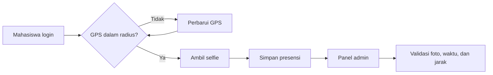

<div align="center">


<a href="https://nextjs.org/"></a>
<a href="https://supabase.com/"></a>
<a href="https://vercel.com/"></a>

<br />

<a href="https://github.com/Jull-kyori/absen-magang"><strong>Lihat repository di GitHub →</strong></a>

<br /><br />


</div>

## Tentang aplikasi

**Presensi Magang** adalah portal presensi digital untuk mahasiswa magang atau PKL di Bakesbangpol Kabupaten Ponorogo. Sistem ini memvalidasi lokasi menggunakan GPS, menyimpan foto selfie sebagai bukti, dan menyediakan panel monitoring untuk pembimbing instansi.

## Fitur utama

| Area | Fitur |
| --- | --- |
| Mahasiswa | Absen masuk dan pulang, GPS geofencing, selfie presensi, riwayat absen, status lokasi real-time |
| Admin | Monitoring presensi harian, grafik tren 7 hari, validasi foto dan GPS, filter mahasiswa, pengaturan radius kantor |
| Sistem | Supabase Auth, role admin/mahasiswa, Row Level Security, storage foto, waktu WIB |
| Tampilan | Responsive mobile, liquid glass, animasi halus, dukungan reduced motion |

## Alur sistem



<details>
<summary><strong>Alur presensi mahasiswa</strong></summary>

1. Mahasiswa masuk menggunakan akun masing-masing.
2. Sistem mengambil koordinat perangkat dan menghitung jarak ke kantor.
3. Tombol presensi aktif jika perangkat berada di dalam radius.
4. Mahasiswa mengambil selfie sebagai bukti.
5. Server menyimpan waktu WIB, koordinat, status, dan foto.
6. Data dapat dipantau oleh admin.

</details>

<details>
<summary><strong>Keamanan akses</strong></summary>

- Data mahasiswa dibatasi dengan Row Level Security Supabase.
- Mahasiswa hanya dapat melihat data presensi miliknya.
- Admin dapat memantau data presensi seluruh mahasiswa.
- Validasi radius dilakukan kembali di server.
- File environment dan service role key tidak boleh dipublikasikan.

</details>

## Menjalankan secara lokal

```bash
git clone https://github.com/Jull-kyori/absen-magang.git
cd ABSENSI-MAGANG
npm install
npm run dev
```

Buka [http://localhost:3000](http://localhost:3000).

Buat file `.env.local` berdasarkan `.env.example`:

```env
NEXT_PUBLIC_SUPABASE_URL=https://project-id.supabase.co
NEXT_PUBLIC_SUPABASE_ANON_KEY=your-anon-key
```

Jangan commit `.env.local` atau `SUPABASE_SERVICE_ROLE_KEY` ke GitHub.

## Database Supabase

Schema, trigger profil, policy RLS, storage, dan pengaturan lokasi tersedia di [supabase/schema.sql](./supabase/schema.sql).

Jalankan file tersebut melalui **Supabase Dashboard > SQL Editor** sebelum menguji presensi.

## Deploy ke Vercel

1. Push repository ke GitHub.
2. Import repository melalui Vercel.
3. Tambahkan environment variables yang sama dengan `.env.local`.
4. Jalankan deployment.

Setiap push ke branch production akan membuat deployment baru secara otomatis.

<div align="center">

</div>
